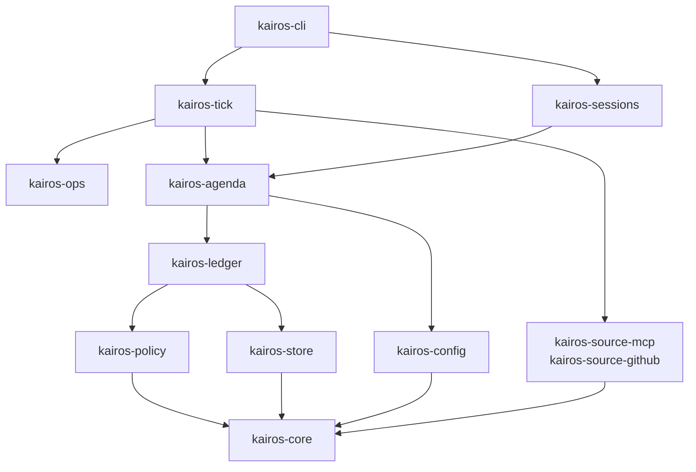

# 구조

kairos의 코드가 어떻게 나뉘어 있는지 설명합니다. 개발 환경과 테스트는 [개발 가이드](development.md)에 있습니다.

## 크레이트

Rust 워크스페이스는 `crates/` 아래에 있습니다. 의존은 위에서 아래로만 흐릅니다. 그림에는 주요 의존만 그렸습니다.

| 크레이트 | 역할 |
|---|---|
| `kairos-cli` | 실행 파일이자 전체를 조립하는 곳. 명령은 `Command`를 구현하고 `registry()`에 한 줄을 추가해 등록합니다 |
| `kairos-tick` | 틱 실행 조율. `TickRunner`, 잠금, 수집 모드, `SourceRegistry`, `Doctor` |
| `kairos-ops` | 큰 응답 파일, 잠자기 판정, 유지보수, 설치 |
| `kairos-sessions` | Orca 연동, run 수명 주기, 세션 프로필 |
| `kairos-agenda` | 항목 엔진, 표시 게이트, 카드, 알림 |
| `kairos-ledger` | 수집 기록. 저장, 멱등 처리, watermark, baseline, 종료 판정 |
| `kairos-policy` | 등급, 종료, 배포 연결, 근무 시간. IO가 없습니다 |
| `kairos-source-mcp`, `kairos-source-github` | 소스 구현 |
| `kairos-store` | DB 연결, 마이그레이션, 트랜잭션 |
| `kairos-config` | 설정 파일 읽기, 값 검증, 계층 병합, 세션 지문, `connections.toml` 쓰기 |
| `kairos-core` | 값 객체, 모델, 포트(trait), 프로필(`profile`), 커넥터 동작 목록(`connector`), JS 호환 유틸 |

## 그 밖의 폴더

| 폴더 | 역할 |
|---|---|
| `packages/kairos-client` | 호스트 공용 TypeScript 클라이언트 |
| `plugins/orca-panel`, `plugins/claude-code`, `plugins/vscode` | 호스트 어댑터 |
| `plugins/collector` | 수집 모드 훅 |
| `ops/` | launchd 템플릿, 감시자, 알림 헬퍼 |
| `profiles/` | 조직 프로필을 두는 곳(git 무시) |
| `examples/` | 합성 값으로 만든 설정 예시 |
| `storybook/` | 플러그인 UI 미리보기 |

호스트와 kairos 사이의 규약은 [호스트 계약](surface-protocol.md)에 있습니다.

## 코드 규칙

- SQL은 `*Repo`에만 씁니다. 시각은 `Clock`, 외부 프로세스는 `ProcessRunner`를 통해 다룹니다.
- 사람이나 조직마다 다른 값은 상수로 두지 않고 `kairos_core::profile::current()`에서 읽습니다. 테스트 빌드는 `test-profile` 기능으로 합성 프로필(`Profile::fixture`)을 씁니다.
- 수집이 끝나면 `StateBuilder`가 `state.json`을 갱신합니다.

### 소스 추가하기

`kairos_core::model`의 `Source`와, `McpSource` 또는 `DirectSource`를 구현하고 `SourceRegistry::standard`에 한 줄을 추가합니다. MCP 소스라면 호출할 읽기 동작을 `kairos_core::connector`에 추가합니다. 빠뜨리기 쉬운 단계까지 담은 절차는 `/add-source` 스킬(`.agents/skills/add-source`)에 있습니다.

## 수집 모드 훅

`plugins/collector`는 Claude Code 모드 엔진이 모델 없이 실행하는 훅입니다. 고쳤다면 `claude plugin validate plugins/collector`를 돌리세요.

> [!IMPORTANT]
> `$`를 넘기는 함수는 반드시 함수 선언이어야 합니다. 화살표 함수로 바꾸면 엔진이 모듈을 거부합니다.

엔진이 모듈을 거부하면 모듈이 로드되지 않아 틱이 `model_called`로 멈춥니다. 이때 모델 요청은 `ANTHROPIC_BASE_URL`(멀티캐스트 `224.0.0.0`)로 향합니다. 커널이 연결을 거절하므로 다른 로컬 사용자가 요청을 받을 수 없습니다. 배포한 뒤 처음 도는 계약 테스트에서 claude가 이 주소로도 지연 없이 실패하는지 확인합니다.
