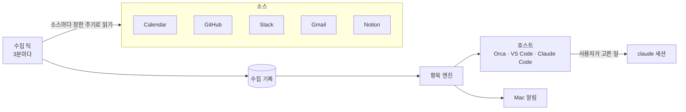

# 핵심 개념

kairos 문서와 화면에 자주 나오는 낱말을 모았습니다. 처음 쓰신다면 이 문서를 먼저 훑어보세요. 다른 문서가 훨씬 쉽게 읽힙니다.

## 전체 흐름

kairos는 소스에서 내게 온 일을 읽어 기록하고, 기록을 바탕으로 할 일(항목)을 엽니다. 그중 지금 볼 일 하나를 골라 호스트에 보여 주고, 급한 일은 Mac 알림으로 알립니다. 사용자가 고른 일은 제한된 claude 세션에 맡길 수 있습니다.

## 수집

### 소스

kairos가 읽는 서비스입니다. Calendar, GitHub, Slack, Gmail, Notion 다섯 가지이고 `kairos sources`로 켜고 끕니다. Notion은 Gmail로 온 Notion 알림 메일을 읽습니다. 자세한 수집 방식은 [소스](sources.md)에 있습니다.

### 틱

수집을 한 번 돌리는 일입니다. launchd가 3분마다 실행하고, 수집 시간(기본 09:00~20:00) 밖의 틱은 수집하지 않고 끝납니다.

### 이벤트

소스에서 읽은 일 하나입니다. 멘션, 리뷰 요청, 댓글, 일정 변경 같은 것이 모두 이벤트입니다.

### 기준선

kairos가 처음 수집할 때 이미 있던 일입니다. 알리지 않고 목록에만 두며, 사람이 새 글을 쓰거나 배포에 연결되면 다시 올라옵니다. 담당 이슈, 내 PR, 리뷰 요청은 `kairos triage`로 10건씩 정리할 수 있습니다.

## 항목과 등급

### 항목

kairos가 보여 주는 할 일 하나입니다. 같은 대상(이슈, PR, Slack 스레드)에 같은 이유로 생긴 이벤트는 한 항목으로 묶입니다. 명령에서는 `#4`의 `4`처럼 항목 ID로 가리킵니다.

### 사유

항목이 열린 이유입니다. `답장 필요`, `리뷰 요청`, `담당 이슈`, `내 PR 확인`, `일정 변경`, `배포 위험`, `할 일`, `직접 추가`가 있습니다.

### 등급

얼마나 급한지를 나타냅니다. 패널에서는 등급 이름 대신 그룹 이름으로 보입니다.

| 등급 | 패널 그룹 | 뜻 |
|---|---|---|
| P0 | 긴급 | 지금 바로 봐야 하는 일. 정책 규칙만 만들 수 있고, 사용자 입력이나 모델 출력으로는 만들 수 없습니다 |
| P1 | 오늘 | 오늘 안에 봐야 하는 일 |
| P2 | 여유 있을 때 | 정해진 묶음 시각에 모아서 보면 되는 일 |
| 기록 | (보이지 않음) | 봇이 쓴 글, 내가 쓴 글처럼 기록만 하는 이벤트 |

어떤 이벤트가 어느 등급이 되는지는 `kairos-policy`의 규칙이 정합니다. `--json` 응답의 `why.rule`에 이 규칙 ID가 나오고, 패널의 `이유`에는 규칙마다 정해진 문장이 나옵니다.

| 등급 | 규칙 | 뜻 |
|---|---|---|
| P0 | `p0.meeting_imminent` | 곧 시작하는 회의 |
| P0 | `p0.deploy_day` | 오늘 배포에 묶인 일이 아직 열려 있음 |
| P1 | `p1.direct_mention` | 나를 직접 언급한 글 |
| P1 | `p1.changes_requested` | 내 PR에 변경 요청 리뷰가 달림 |
| P1 | `p1.ci_failed` | 내 PR의 CI 검사가 실패함 |
| P1 | `p1.review_rerequested` | 고친 뒤 리뷰를 다시 요청받음 |
| P1 | `p1.deploy_d1` | 내일 배포에 묶인 일이 아직 열려 있음 |
| P1 | `p1.deploy_owned_comment` | 배포에 묶인 내 일에 새 댓글이 달림 |
| P1 | `p1.app_review_mail` | 앱 심사 결과 메일 |
| P1 | `p1.sentry_mail` | Sentry 오류 알림 메일 |
| P1 | `p1.notion_mention` | Notion에서 나를 언급함 |
| P2 | `p2.assigned` | 담당자로 지정됨 |
| P2 | `p2.review_requested` | 리뷰를 요청받음 |
| P2 | `p2.owned_comment` | 내가 만든 일에 새 댓글이 달림 |
| P2 | `p2.multi_mention` | 여러 사람과 함께 언급됨 |
| P2 | `p2.figma_ready` | Figma 디자인이 준비됐다는 메일 |
| P2 | `p2.notion_comment` | Notion 페이지에 새 댓글이 달림 |
| P2 | `p2.notion_unknown` | 형식을 모르는 Notion 메일 |
| P2 | `p2.meeting_change` | 일정이 새로 잡혔거나 바뀜 |

### 신뢰 등급

글쓴이를 T0부터 T3까지 네 단계로 나눈 기준입니다. T0는 본인, T1은 조직의 사람, T2는 봇과 연동, T3는 외부입니다. 조직의 사람인지는 [조직 프로필](configuration.md#조직-프로필)의 GitHub 조직과 신뢰 도메인으로 판단합니다. 세션에 맡길 수 있는 일인지, 배포 일정을 믿을지 정할 때 씁니다.

## 보여 주기

### 지금 볼 일

`kairos next`가 고른 한 건입니다. 패널 맨 위에 카드로 나옵니다.

### 묶음

P2 일을 모아서 보여 주는 시각입니다. 기본값은 13:30과 18:00입니다. `kairos later`는 옵션이 없으면 다음 묶음 시각까지 미룹니다.

### 표시 게이트

카드와 알림을 낼지 정하는 스위치입니다. `kairos display on|off|auto`로 바꿉니다. 게이트가 닫혀 있어도 수집과 기록은 계속됩니다. auto는 첫 근무일 동안 기록만 합니다. 표시 모드를 고른 적이 없다면 `kairos setup`으로 설치할 때 on이 됩니다.

### 예산

'지금 볼 일' 카드가 너무 자주 뜨지 않게 막는 한도입니다. 예를 들어 P1 카드는 시간당 1건, 하루 4건까지입니다. 패널 목록, 상태 표시줄 건수, Mac 알림에는 적용하지 않습니다.

### 노출

화면이 카드를 실제로 보여 준 기록입니다. 호스트가 `kairos next --seen`으로 남기고, 예산은 노출로 셉니다.

### 보류

포커스 중, 점심시간, 근무 시간 밖에는 카드와 알림을 내지 않고 쌓아 두었다가, 끝난 뒤 한 번에 알립니다. 쉬는 날에는 카드를 내지 않고, 그날 처음 잡힌 P1은 알림 없이 패널에만 남깁니다. P0 카드는 보류하지 않습니다.

### 쉬는 날

근무 요일이 아닌 날, 공휴일, 연차 캘린더의 연차, `kairos off`로 적은 날입니다.

자세한 규칙은 [항목과 알림](items.md)에 있습니다.

## 세션

### 세션

사용자가 고른 항목을 맡긴 claude입니다. 샌드박스와 읽기 전용 GitHub 토큰을 갖춘 상태로만 뜨고, 외부에 글을 쓸 수 없습니다.

### 플레이북

세션이 하는 일의 종류입니다. 내 담당 이슈를 고치는 `qa_issue`, 리뷰 의견 초안을 쓰는 `pr_review`, 답변 초안을 쓰는 `reply_draft`가 있습니다.

### 수락

항목을 세션에 맡기는 일입니다. 패널의 `세션 열고 시작` 버튼이 `kairos accept`를 호출합니다.

### run

세션 한 번의 실행 기록입니다. `claimed`, `started`, `waiting_user`, `needs_attention`, `ended`, `failed` 같은 상태를 거칩니다.

### 세션 잠금

차단 테스트를 마치기 전에 세션이 열리지 않도록 막는 잠금입니다. `kairos sessions on`으로 풀고, 세션 자격에 영향을 주는 설정이 바뀌면 다시 잠깁니다.

### 차단 테스트

세션을 켜기 전에 외부 쓰기가 정말 막히는지 사용자가 직접 확인하는 점검입니다. CLI 메시지에는 '차단 시험'으로 나옵니다.

### 준비됨 카드

세션이 답을 기다리거나, 끝났거나, 확인이 필요하거나, 실패했을 때 알려 주는 카드입니다. 패널에서는 '세션 소식'으로 보입니다.

자세한 내용은 [에이전트 세션](sessions.md)에 있습니다.

## 화면과 설정

### 호스트

kairos를 보여 주는 프로그램입니다. Orca 패널, Claude Code 플러그인, VS Code 확장이 있습니다. 판단은 kairos가 하고, 호스트는 화면을 그리고 버튼을 전달하기만 합니다. 규약은 [호스트 계약](surface-protocol.md)에 있습니다.

### 세션 호스트

세션을 띄우는 곳입니다. Orca worktree를 쓰는 `orca`(기본값)와 로컬 클론에 worktree를 만드는 `git`이 있습니다.

### 조직 프로필

회사 도메인, 그룹 캘린더, 저장소처럼 조직마다 다른 값을 담은 `org.toml`입니다. 관리자가 따로 나눠 주며 저장소에는 넣지 않습니다.

### 데이터 폴더

설정, 수집 기록, 설치본을 두는 `~/Library/Application Support/kairos`입니다. `KAIROS_HOME`으로 바꿀 수 있습니다. 지금 쓰는 설치본은 `<데이터 폴더>/current`입니다.
